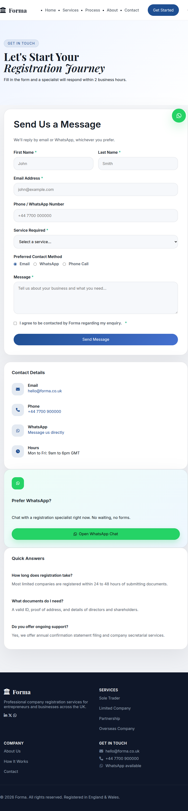

# Forma: static company registration site on Amazon S3

A small static marketing site for a fictional company formation firm, deployed to
Amazon S3 static website hosting.

**Live:** deactivated. The site was served at
`http://regpro-static-1794723485.s3-website-us-east-1.amazonaws.com` until
25 November 2026, when the bucket was emptied and deleted during an account
cleanup. That address no longer resolves. Run `./deploy.sh` to publish it again
on a new bucket, which will produce a new address.

This started as Project 1 of an AWS engineering series, where the brief was S3
plus CloudFront plus ACM plus Route 53. CloudFront is blocked on the account used
here, so the site runs on the S3 website endpoint instead. The reasoning is
documented under [Why no CloudFront](#why-no-cloudfront).

---

## What the site is

Two pages for **Forma**, a made up company registration service:

| Page | Contents |
|---|---|
| `index.html` | Hero, four services (sole trader, limited company, partnership, overseas), four step process, about, testimonials, call to action, footer |
| `contact.html` | Enquiry form with validation, contact details, WhatsApp card, FAQ, map placeholder |

The contact form does not post to a backend. It validates input in the browser and
opens a pre filled `mailto:` message, so no server or form service is involved.

All content is fictional. The phone number `+44 7700 900000` is Ofcom's reserved
range for drama and example use.

## Screenshots

Home page hero:


Contact page:


Full pages, captured at 785px wide:




## Architecture

```
        visitor
           |
           v
  S3 website endpoint          regpro-static-1794723485
  (public read, static        us-east-1
   website hosting)                |
                                   +-- index.html
                                   +-- contact.html
                                   +-- css/styles.css
                                   +-- js/main.js
```

This is the architecture that was deployed. The bucket was deleted on
25 November 2026, so the diagram describes the design rather than a live
deployment. `./deploy.sh` rebuilds the same shape under a new bucket name.

There is no compute, no database, and no server side code. Four objects are served
directly from S3.

### Caching policy

| Object | Cache-Control | Reason |
|---|---|---|
| `*.html` | `public, max-age=0, must-revalidate` | Content changes must appear immediately |
| `css/`, `js/` | `public, max-age=31536000, immutable` | Cheap repeat loads |

Because the CSS and JavaScript are marked immutable for a year, editing them
requires a new filename or a version query string. Re uploading alone will not
reach visitors who already have a cached copy.

## Repository layout

```
.
├── index.html            Home page
├── contact.html          Contact page
├── css/styles.css        All styling, including the layout fixes below
├── js/main.js            Form validation and mailto construction
├── deploy.sh             Creates the bucket, configures hosting, uploads
├── destroy.sh            Empties and deletes the bucket
└── reference/
    ├── deploy-website.sh   Original cloudfront script, needs a verified account
    └── cleanup-website.sh  Original teardown, see the caveat below
```

The two scripts in `reference/` come from the original project brief. They target a
private bucket behind CloudFront with an origin access control, which cannot be
created on the account used here. They are kept for reference and are not the
deployment path.

> **Caveat:** `reference/cleanup-website.sh` parses `deployment-info.txt` with
> incorrect awk field offsets (`$5` and `$4`), so it silently skips the CloudFront
> distribution and origin access control instead of deleting them. It also omits
> `--region` on most S3 calls. Read it before running it.

## Local preview

Any static file server works. Python ships with one:

```bash
python3 -m http.server 8000
# then open http://localhost:8000
```

Opening `index.html` directly with `file://` also works, but relative paths and
the form behaviour are better tested over HTTP.

## Deploying

Requires the AWS CLI v2, credentials with permission to manage S3, and a region.
The script defaults to `us-east-1`.

```bash
export AWS_REGION=us-east-1
export BUCKET=forma-static-$(date +%s)
./deploy.sh
```

The script performs these steps:

1. Creates the bucket. For any region other than `us-east-1` it passes a
   `LocationConstraint`.
2. Tags the bucket with `Project`, `ManagedBy` and `Environment`.
3. Turns off block public access. A website endpoint cannot serve a private bucket.
4. Enables the static website configuration, with `index.html` as both index and
   error document.
5. Attaches a bucket policy granting `s3:GetObject` to everyone.
6. Uploads the HTML with revalidation caching and the CSS and JavaScript with long
   lived caching.

It prints the website URL when it finishes.

### Cost

Storage is a few hundred kilobytes and request volume is negligible, so this sits
inside the S3 free tier. There is no always on resource. The only way this costs
money is a large amount of traffic.

## Tearing down

```bash
BUCKET=forma-static-1794723485 ./destroy.sh
```

This deletes every object in the bucket and then the bucket itself, and it asks for
confirmation first. An S3 bucket cannot be deleted while it still contains objects,
which is why the script empties it.

The bucket used during development, `regpro-static-1794723485`, was removed this
way on 25 November 2026. The script stays in the repo for any bucket you create
with `deploy.sh` later.

## Why no CloudFront

Creating a distribution on this account fails with:

```
AccessDenied: Your account must be verified before you can add new CloudFront resources.
To request verification, contact AWS Support.
```

This is an account level verification gate, not an IAM or configuration problem.
It cannot be fixed from the console or the API. It needs an AWS Support case under
Account and billing, and in some countries CloudFront is simply not available.

Consequences of running on the S3 website endpoint:

| Impact | Detail |
|---|---|
| No HTTPS | S3 website endpoints are HTTP only. Browsers mark the site as not secure |
| No HTTP/2 | Only HTTP/1.1 is served |
| No edge caching | Every request reaches the bucket directly |
| Public bucket required | Website hosting cannot serve private content |
| No custom domain | The bucket name is the URL |

The alternative was an Application Load Balancer in front of the bucket, which
cannot serve static S3 content and costs roughly 18 USD per month, so it was not
pursued.

## Changes made to the original site

The original markup had several genuine bugs, not just styling preferences.

| Issue | Cause | Fix |
|---|---|---|
| Hero statistics collided with the buttons | `.hero-stats`, `.stat` and `.stat-sep` had no CSS rules at all | Styled as a bordered statistic row, clear of the buttons |
| Contact details read "Emailhello@example.com" | `<strong>` and `<a>` were inline siblings with no break | Label now sits above the value |
| Footer columns appeared as white cards on a dark footer | `.footer-col` shares a rule with `.info-card` that sets a white background, border, radius, shadow and 2rem padding | Reset to transparent with no border or padding |
| Call to action banner squeezed its paragraph to one word per line | The banner container had three flex children (heading, paragraph, buttons) | Copy wrapped in `.cta-copy` so the container has two children |
| Section labels were nearly invisible on light backgrounds | `.tag` shared the translucent white pill style written for the dark hero | Light variant with a tinted background and a border |
| Consent checkbox sat far from its text | The global `input { width: 100% }` rule stretched checkboxes across the row | Checkbox and radio inputs reset to auto width |
| Contact page heading sat flush against the window edge | `.page-hero-inner` had a max width but no container width or centering | Given the same container width as the rest of the page |
| "Start Today" disappeared into the call to action banner | The primary button used the same blue as the banner behind it | Inverted to a white button with blue text |
| Hero statistics spilled onto the section below on short windows | The hero box was pinned to 85vh while its content was taller | The hero sizes to its content below 760px of viewport height |

Additional polish: consistent button height and width, visible focus outlines,
WhatsApp button shadow, floating WhatsApp button that respects safe area insets and
clears the footer copyright, stacked buttons on narrow screens, and support for
`prefers-reduced-motion`.

Copy changes: the brand was renamed from RegPro to Forma, and every dash character
was removed from the visible text, including en dashes in the opening hours and the
registration time range, and the dash in the generated email subject line.

## Known gaps

- The mobile layout below 760px is written but was never visually verified. The
  browser available during development was fixed at roughly 800px wide.
- No analytics, no error page, no favicon.
- The testimonials and the statistics are placeholder content.
- Images are hot linked from Unsplash and avatar services, and Google Fonts and
  Font Awesome load from CDNs, so the page depends on third party availability.

## License

The site content is fictional and provided as a learning exercise. Use it freely.
